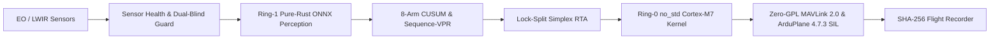

<p align="center">
  
</p>

<p align="center">
  
  
  
  
</p>

**OpenXVS `v1.1.0`** is a civil and dual-use autonomous aviation stack for GNSS-denied visual navigation, passive EO/LWIR detect-and-avoid, and formally verified Simplex runtime assurance. All geometry strictly uses WGS-84 ECEF, Local NED, Body FRD, and Camera RDF (`0` internal ENU) with hard `NON_FLIGHT_SIM_ONLY=1` and `ACTUATOR_AUTHORITY=false` safety locks.

<p align="center"><a href="https://github.com/fahrifurkansagir/OpenXVS/releases/tag/v1.1.0"></a></p>

<p align="center"><em>12-second preview from real open-licensed footage &amp; live telemetry &mdash; <a href="https://github.com/fahrifurkansagir/OpenXVS/releases/tag/v1.1.0">watch full 86 s HD 720p30 demonstration (<code>openxvs_v1.1.0_demo.mp4</code>) on Release v1.1.0</a>.</em></p>

## Architecture



## Verified Benchmarks (`v1.1.0`)

| Domain | Verified Evidence | Verdict |
| :--- | :--- | :---: |
| **Ring-0 Formal** | `26/26` Kani CBMC, Apalache TLA+ unbounded (`N=2/3`), QEMU Cortex-M7 `10,000` ticks (`77,917` invariants, `0` violations, `88 KB` Flash, `0 B` heap/static RAM; emulation only) | **PASS** |
| **Python-Rust Parity** | Byte-identical `nav_integrity.rs`: `SequenceVprFilter` `max_abs_diff = 1.82e-12`, `DualBankEsEkfCusum` (`10,701` epochs) `2.91e-11`, `100%` exact discrete alarm parity | **PASS** |
| **Lock-Split RTA** | Decoupled `RealtimeSafetyState` + wait-free `OnceLock`: concurrent RTA latency `104.58 ms -> 0.0061 ms` p95 (`17,144x` reduction under 6-model load) | **PASS** |
| **Live `ArduPlane 4.7.3` SIL** | `7/7` continuous mission phases (`33.45 s`, `15 m/s` crosswind, live spoof `TTD = 10.0 s`, `2x ACK 42007=0`, stall-free `19.47 m/s`, `0` `#84`, `SimplexRta P0->P1->P4`) | **PASS** |
| **Headless Soak & Integrity** | `305 s` 6-model soak (`+0.15 MiB` RSS, `-3` handles), `24`-record SHA-256 tape verified in Python & Rust (`--replay` 1-byte tamper exit `1`), `696+` Py / `30` Rust tests | **PASS** |

## Quick Verify

```bash
openxvs-edge-infer --self-check
openxvs-edge-infer --replay mission_flight_tape.ndjson
cargo test --manifest-path docker/edge-infer/Cargo.toml --locked
```

## Documentation

- [`docs/ARCHITECTURE.md`](docs/ARCHITECTURE.md) — Ring-0/Ring-1 separation, NED/FRD/RDF coordinates, 8-arm CUSUM, and fail-closed optical/LWIR health
- [`docs/VERIFICATION.md`](docs/VERIFICATION.md) — Formal proofs, Python-Rust parity, lock-split RTA, `305 s` soak, `7/7` `ArduPlane 4.7.3` SIL, and `18` hardened fixes
- [`docs/LIMITATIONS.md`](docs/LIMITATIONS.md) — Unseen real-world perception boundaries and physical hardware/flight-test domains pending qualification

**Scope & Maturity:** Civil/dual-use research and bench SIL evaluation only (`NON_FLIGHT_SIM_ONLY=1`, `ACTUATOR_AUTHORITY=false`) — not certified by the FAA, EASA, or any civil aviation authority. Unseen real-world perception limits and unverified physical hardware domains are documented candidly in [`docs/LIMITATIONS.md`](docs/LIMITATIONS.md).

---

**Authorship, Attribution & License:** Architected and authored by **Fahri Furkan Sağır** ([@fahrifurkansagir](https://github.com/fahrifurkansagir)) &bull; Licensed under `Apache-2.0` ([`LICENSE`](LICENSE)) with mandatory §4(d) attribution preservation ([`NOTICE`](NOTICE)) &bull; Ownership in [`.github/CODEOWNERS`](.github/CODEOWNERS) &bull; Security policy in [`SECURITY.md`](SECURITY.md) &bull; SHA-256 verified binaries, ONNX models &amp; demo video (`SHA256SUMS.txt`) on [Release `v1.1.0`](https://github.com/fahrifurkansagir/OpenXVS/releases/tag/v1.1.0).
