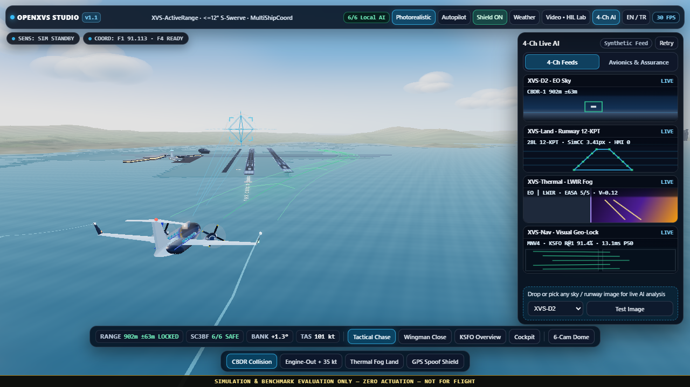

<p align="center">
  
</p>

<p align="center">
  
  
  
  
</p>

OpenXVS is an open-source, pure-Rust autonomous aviation stack for GPS-denied visual navigation, optical/thermal detect-and-avoid, and formally verified flight safety.

<p align="center"><a href="https://github.com/fahrifurkansagir/OpenXVS/releases/tag/v1.1.1"></a></p>

<p align="center"><em>Live preview of OpenXVS Studio &mdash; <a href="https://github.com/fahrifurkansagir/OpenXVS/releases/tag/v1.1.1">watch the full 64 s HD story demo (<code>openxvs_v1.1.1_demo.mp4</code>, 4.16 MiB) on Release v1.1.1</a>.</em></p>

## What OpenXVS Does

- **GPS-Denied Navigation:** Matches live downward imagery against reference maps and catches GPS spoofing with a dual-bank Kalman filter and 8-directional CUSUM monitor.
- **Optical & Thermal Detect-and-Avoid:** Tracks non-cooperative airborne traffic and landing corridors with passive EO/LWIR ONNX models guarded by real-time shutter-freeze, dead-pixel, and dual-blind fail-closed monitors.
- **Formally Verified Safety Kernel:** Isolates flight-safety decisions in a bare-metal `#![no_std]` Rust Simplex Runtime Assurance core (`88 KB` Flash, `0 B` heap) paired with a zero-GPL MAVLink 2.0 bridge and tamper-evident SHA-256 flight recorder.

## OpenXVS Studio

| 3D Collision Avoidance | G1000 Glass Cockpit | 360° 6-Camera Dome & Spoof Shield |
| :---: | :---: | :---: |
|  |  |  |

## Verified Highlights (`v1.1.1`)

| Capability | Verified `v1.1.1` Evidence |
| :--- | :--- |
| **Pure-Rust ONNX Runtime** | `20–36 ms` warm CPU inference across primary models (`10.1 ms` XFeat), `6/6` SHA-256 pinned ONNX weights, `0` deadline misses in `5 Hz` soak (`+0.17 MiB` RSS) |
| **Async Lock-Split Safety** | `0.038 ms` p95 Simplex RTA latency (`0.172 ms` max health snapshot) under concurrent 6-model ONNX load via `spawn_blocking` + wait-free snapshots |
| **Live `ArduPlane 4.7.3` SIL** | `7/7` continuous mission phases (`15 m/s` crosswind, `10.0 s` live spoof detection, `2x ACK 42007=0`, stall-free `19.54 m/s`, `0` `#84`, `24`-record SHA-256 replay) |
| **Bare-Metal Formal Kernel** | `26/26` Kani CBMC proofs, Apalache TLA+ unbounded (`N=2/3`), QEMU Cortex-M7 `10,000` ticks (`77,917` invariants, `0` violations, `88 KB` Flash, `0 B` heap/RAM) |
| **Automated Test Suites** | `696+` Python tests, `37` Rust tests (`16` Edge CLI + `21` Studio), `15` Studio Vitest specs, `0` Clippy warnings, `0` GPL dependencies |

## Quick Start

### 1. Run Prebuilt Windows Evaluation Bundles (Zero Setup)

Download from [GitHub Release `v1.1.1`](https://github.com/fahrifurkansagir/OpenXVS/releases/tag/v1.1.1) and verify against `SHA256SUMS.txt`:

- **3D Workstation:** Unzip `OpenXVS-Studio-Win64-v1.1.1.zip` and double-click `openxvs-studio.exe`.
- **Headless Edge CLI (zero env vars required):** Unzip `OpenXVS-Edge-CLI-Win64-v1.1.1.zip` and run:

```powershell
.\openxvs-edge-infer.exe --self-check --require-models
.\openxvs-edge-infer.exe --replay samples\mission_flight_tape.ndjson
```

### 2. Build & Verify from Source

```bash
cargo test --manifest-path docker/edge-infer/Cargo.toml --locked
cargo test --manifest-path apps/studio/src-tauri/Cargo.toml --locked
pytest -q
```

## Repository Map

| Path | Role |
| :--- | :--- |
| `apps/studio/` | Native Tauri v2 + Three.js 3D workstation, G1000 cockpit, and live 6-model ONNX monitor |
| `docker/edge-infer/` | Headless pure-Rust ONNX CLI (`--self-check`, `--soak`, `--replay`, `--parity-eval`) and ARM64 OCI recipes |
| `xvs-*` | Bare-metal `#![no_std]` `#![forbid(unsafe_code)]` safety kernel crates, Kani harnesses, and TLA+ specs (`formal/`) |
| `src/xvs/` & `docs/` | Zero-GPL MAVLink 2.0 bridge, `ArduPlane 4.7.3` SIL harness, perception modules, verification & legal docs |

## Documentation & Scope

- [`docs/ARCHITECTURE.md`](docs/ARCHITECTURE.md) &bull; [`docs/VERIFICATION.md`](docs/VERIFICATION.md) &bull; [`docs/LIMITATIONS.md`](docs/LIMITATIONS.md) &bull; [`docs/legal/`](docs/legal/)
- **Civil Research & Simulation Scope:** Evaluation binaries compile with `NON_FLIGHT_SIM_ONLY=1` and `ACTUATOR_AUTHORITY=false` — not certified by the FAA, EASA, or any civil aviation authority.

---

**Authorship & License:** Architected and authored by **Fahri Furkan Sağır** ([@fahrifurkansagir](https://github.com/fahrifurkansagir)) &bull; `Apache-2.0` ([`LICENSE`](LICENSE)) + mandatory §4(d) attribution ([`NOTICE`](NOTICE)) &bull; [`.github/CODEOWNERS`](.github/CODEOWNERS) &bull; [`SECURITY.md`](SECURITY.md) &bull; `SHA256SUMS.txt` on [Release `v1.1.1`](https://github.com/fahrifurkansagir/OpenXVS/releases/tag/v1.1.1).
