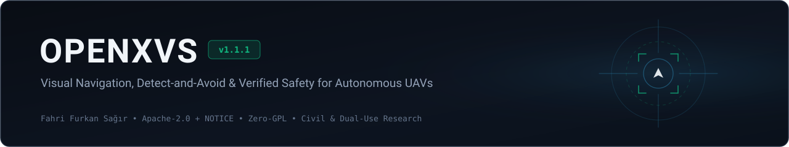
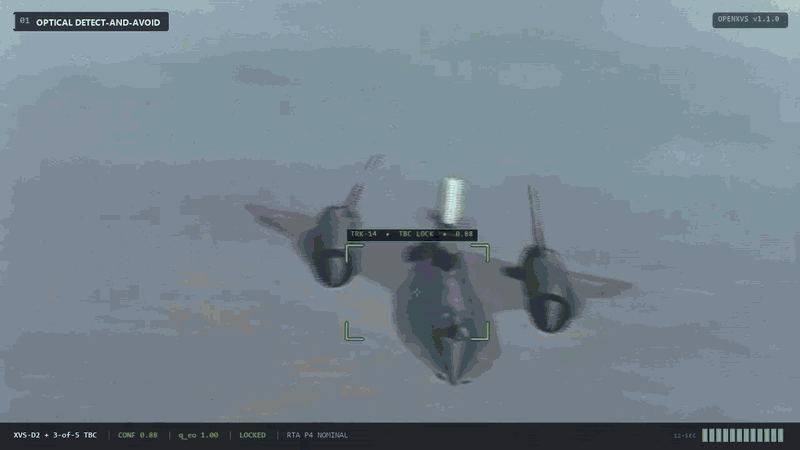
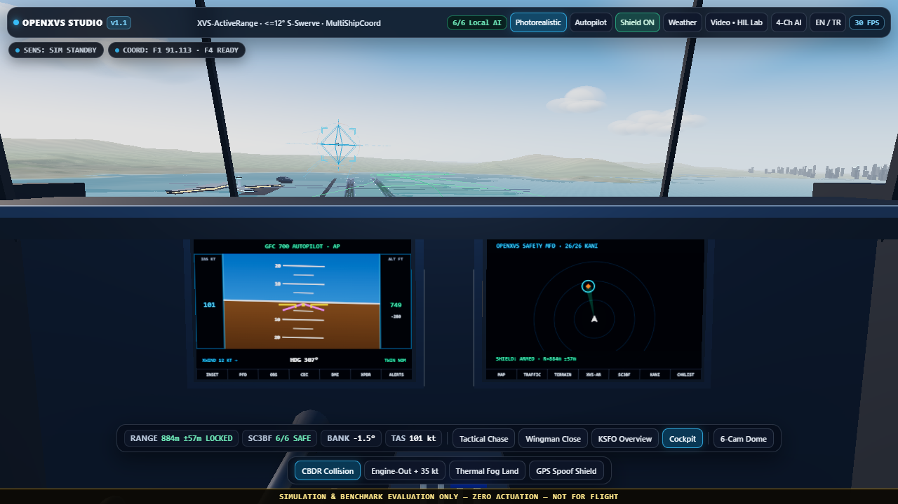
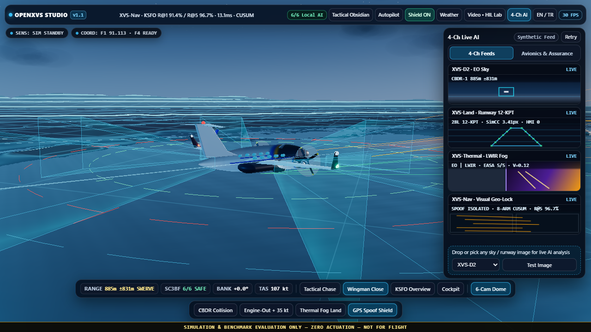

<p align="center">
  
</p>

<p align="center">
  <a href="https://github.com/fahrifurkansagir/OpenXVS/actions/workflows/xvs_core_ci.yml"></a>
  <a href="https://github.com/fahrifurkansagir/OpenXVS/actions/workflows/xvs_edge_arm64_oci.yml"></a>
  
  
  
  
</p>

OpenXVS is an open-source, pure-Rust autonomous aviation stack for GPS-denied visual navigation, optical/thermal detect-and-avoid, and formally verified flight safety.

<p align="center"><a href="https://github.com/fahrifurkansagir/OpenXVS/releases/tag/v1.1.2"></a></p>

<p align="center"><em>Release v1.1.2 videos &mdash; <a href="https://github.com/fahrifurkansagir/OpenXVS/releases/tag/v1.1.2">watch the 64 s HD story demo (<code>openxvs_v1.1.2_demo.mp4</code>, 4.16 MiB) and 44 s plain-English 9-clip real-video proof reel (<code>openxvs_v1.1.2_real_video_benchmark.mp4</code>, 3.89 MiB)</a>.</em></p>

## What OpenXVS Does

- **GPS-Denied Navigation:** Matches live downward imagery against reference maps and catches GPS spoofing with a dual-bank Kalman filter and 8-directional CUSUM monitor.
- **Optical & Thermal Detect-and-Avoid:** Tracks non-cooperative airborne traffic and landing corridors with passive EO/LWIR ONNX models guarded by native-resolution shutter-freeze, dead-pixel, and dual-blind fail-closed monitors.
- **Formally Verified Safety Kernel:** Isolates flight-safety decisions in a bare-metal `#![no_std]` Rust Simplex Runtime Assurance core (`88 KB` Flash, `0 B` heap) paired with zero-GPL ArduPilot & PX4 MAVLink 2.0 bridges and a tamper-evident SHA-256 flight recorder.

## OpenXVS Studio

| 3D Collision Avoidance | G1000 Glass Cockpit | 360° 6-Camera Dome & Spoof Shield |
| :---: | :---: | :---: |
|  |  |  |

## Verified Highlights (`v1.1.2`)

| Capability | Verified `v1.1.2` Evidence |
| :--- | :--- |
| **Pure-Rust `--eval-frames` & ONNX** | **`108 ms` p50** (`121.7 ms` p95) 3-model evaluation on real up-to-1080p footage (`1.58 MiB` CLI, `6/6` SHA-256 ONNX weights, `0` deadline misses in `5 Hz` soak, Jetson Orin `build_trt_engines.sh`) |
| **9-Clip Real-Video Benchmark** | `9` open-licensed aviation clips across air-to-air, unseen cockpit landing, aerial drone nav (`2.15x–2.50x` BGR-to-RGB inlier lift, `3.4 s` spoof catch), and thermal IR faults (`1`-frame FPN/noise catch) &mdash; **`0` HMI** |
| **Compound `ArduPlane 4.7.3` SIL & PX4** | **`8/8` simultaneous 4-fault live flight** (`15 m/s` crosswind + `9.0 s` GPS spoof + `90 deg` heading rescue + LWIR freeze + stall-free `20.75 m/s` DAA, `0` `#84`) + zero-GPL PX4 MAVLink 2.0 (`#102/#331`) |
| **Bare-Metal Formal Kernel & RTA** | **`26/26` Kani CBMC proofs live in CI**, Apalache TLA+ unbounded (`N=2/3`), QEMU Cortex-M7 `10,000` ticks (`88 KB` Flash, `0 B` heap), `0.038 ms` p95 wait-free Studio RTA |
| **Test Suites & Runtime Hardening** | **`717+` Python tests**, **`47` Rust tests** (`26` Edge CLI + `21` Studio), **`15` Studio Vitest specs**, `8` runtime/safety bug fixes verified, **`0` Clippy warnings**, `0` GPL dependencies |

## Quick Start

### 1. Run Prebuilt Windows Evaluation Bundles (Zero Setup)

Download from [GitHub Release `v1.1.2`](https://github.com/fahrifurkansagir/OpenXVS/releases/tag/v1.1.2) and verify against `SHA256SUMS.txt`:

- **3D Workstation:** Unzip `OpenXVS-Studio-Win64-v1.1.2.zip` and double-click `openxvs-studio.exe`.
- **Headless Edge CLI (zero env vars required):** Unzip `OpenXVS-Edge-CLI-Win64-v1.1.2.zip` and run:

```powershell
.\openxvs-edge-infer.exe --self-check --require-models
.\openxvs-edge-infer.exe --eval-frames samples\frames --mode all --out report.json --tape eval_tape.ndjson
.\openxvs-edge-infer.exe --replay eval_tape.ndjson
.\openxvs-edge-infer.exe --replay samples\mission_flight_tape.ndjson
```

### 2. Build & Verify from Source

```bash
cargo test --manifest-path docker/edge-infer/Cargo.toml --locked
cargo test --manifest-path apps/studio/src-tauri/Cargo.toml --locked
pytest -q
```

## Repository Map

| Path | Role |
| :--- | :--- |
| `apps/studio/` | Native Tauri v2 + Three.js 3D workstation, G1000 cockpit, and live 6-model ONNX monitor |
| `docker/edge-infer/` | Headless pure-Rust ONNX CLI (`--self-check`, `--eval-frames`, `--soak`, `--replay`, `--parity-eval`), ARM64 OCI & Orin `build_trt_engines.sh` |
| `xvs-*` | Bare-metal `#![no_std]` `#![forbid(unsafe_code)]` safety kernel crates (`26/26` Kani CI) and TLA+ specs (`formal/`) |
| `src/xvs/`, `scripts/xvs/`, `samples/` | Zero-GPL ArduPilot & PX4 (`#102/#331`) MAVLink 2.0 bridges, compound SIL & real-video benchmarks, and real sample frames |

## Documentation & Scope

- [`docs/ARCHITECTURE.md`](docs/ARCHITECTURE.md) &bull; [`docs/VERIFICATION.md`](docs/VERIFICATION.md) &bull; [`docs/LIMITATIONS.md`](docs/LIMITATIONS.md) &bull; [`docs/legal/`](docs/legal/)
- **Civil Research & Simulation Scope:** Evaluation binaries compile with `NON_FLIGHT_SIM_ONLY=1` and `ACTUATOR_AUTHORITY=false` — not certified by the FAA, EASA, or any civil aviation authority.

---

**Authorship & License:** Architected and authored by **Fahri Furkan Sağır** ([@fahrifurkansagir](https://github.com/fahrifurkansagir)) &bull; `Apache-2.0` ([`LICENSE`](LICENSE)) + mandatory §4(d) attribution ([`NOTICE`](NOTICE)) &bull; [`.github/CODEOWNERS`](.github/CODEOWNERS) &bull; [`SECURITY.md`](SECURITY.md) &bull; `SHA256SUMS.txt` on [Release `v1.1.2`](https://github.com/fahrifurkansagir/OpenXVS/releases/tag/v1.1.2).
